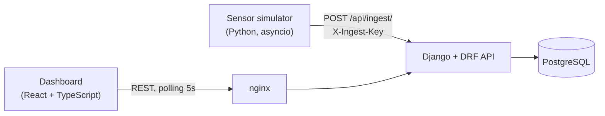

# Intersection Pulse

Real-time traffic monitoring for connected intersections.

Simulated edge sensors stream per-approach readings (vehicle count, speed, queue
length, pedestrians) to a Django REST API backed by PostgreSQL. A React +
TypeScript dashboard shows the live congestion level of every intersection on a
map, with per-approach statistics and a volume/speed time series.


## Architecture



| Service      | Stack                                   | Role |
|--------------|-----------------------------------------|------|
| `backend`    | Python 3.12, Django 5, DRF, PostgreSQL  | Intersections CRUD, bulk ingestion, traffic analytics |
| `simulator`  | Python, asyncio, httpx                  | Microservice emulating edge sensors with rush hours and random incidents |
| `frontend`   | React 19, TypeScript, Vite, Recharts, Leaflet | Live map, per-approach stats, time-series chart |
| `db`         | PostgreSQL 16                           | Storage |

## Quick start

```bash
docker compose up --build
```

- Dashboard: http://localhost:3000
- API: http://localhost:8000/api/
- Demo intersections are seeded automatically and the simulator starts pushing data within seconds.

### Without Docker

```bash
# Backend (SQLite fallback when POSTGRES_HOST is not set)
cd backend
pip install -r requirements-dev.txt
python manage.py migrate && python manage.py seed_intersections
python manage.py runserver

# Simulator
cd simulator && pip install -r requirements.txt && python simulator.py

# Frontend (proxies /api to localhost:8000)
cd frontend && npm install && npm run dev
```

## API

| Method | Endpoint | Description |
|--------|----------|-------------|
| GET    | `/api/health/` | Liveness + database readiness probe |
| GET/POST | `/api/intersections/` | List / create intersections (filters: `city`, `is_active`) |
| GET    | `/api/intersections/overview/?minutes=15` | Every active intersection with its live congestion, in one grouped query |
| GET    | `/api/intersections/{id}/stats/?minutes=15` | Per-approach volume, speed, max queue and congestion level |
| GET    | `/api/intersections/{id}/timeseries/?minutes=60&bucket=5` | Volume and average speed per time bucket |
| GET    | `/api/detections/?intersection=1&approach=N&since=...` | Raw readings, filtered and paginated |
| POST   | `/api/ingest/` | Bulk ingestion (max 1000 readings per batch), service-to-service key auth |

### Congestion score

Each approach gets a 0–1 score blending queue length (60 %, saturating at 80 m)
and speed drop relative to a 50 km/h free-flow speed (40 %):
`low < 0.33 ≤ moderate < 0.66 ≤ high`. The logic lives in
`backend/traffic/services.py`, separate from the views, so it is unit-tested
without HTTP.

## Design choices

- **Bulk ingestion** with `bulk_create` inside a transaction: one HTTP call and one insert per batch, instead of one per reading.
- **Composite index** `(intersection, observed_at)` matching the dominant query: "readings of intersection X since T".
- **Aggregation in the database** (`values().annotate()`), including the network overview computed in a single grouped query to avoid N+1.
- **Service-to-service auth** on ingestion with a shared key compared in constant time (`hmac.compare_digest`).
- **Resilient simulator**: waits for the backend health check, retries with exponential backoff on 5xx/network errors, never retries 4xx, shuts down gracefully on SIGTERM.
- **12-factor config**: everything through environment variables; the same image runs locally, in CI and in a container platform.
- **Frontend polling hook** that aborts in-flight requests when the selection changes, so a slow response never overwrites newer data.

## Tests and CI

```bash
cd backend && pytest          # API + analytics (runs on SQLite or PostgreSQL)
cd simulator && pytest        # traffic model
cd frontend && npm test       # React components (Vitest + Testing Library)
```

GitHub Actions runs linting (ruff), a migration check, the backend tests against
a real PostgreSQL service container, the simulator and frontend tests, the
production build, and finally builds all Docker images.

## Next steps

- Move high-volume detections to a columnar store such as ClickHouse (or TimescaleDB), keeping PostgreSQL for reference data.
- Push live updates over WebSockets (Django Channels) instead of polling.
- Deploy the services on AWS (ECS Fargate + RDS) with Terraform.
